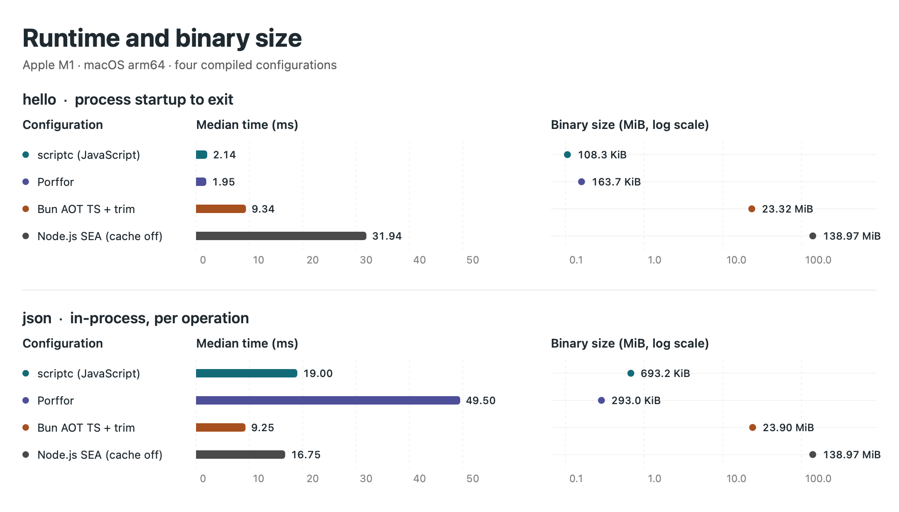

# ランタイム・コンパイラのベンチマーク（2026-11-21）

Apple M1 の macOS arm64 で、依存更新後のコミット `46a98bc` にある実行構成を計測した。短いコマンドの起動、数値ループ、JSON 加工で、構成ごとの得意な処理を比較した。

- **起動込みの `hello`** では、Spinel・Lython・Porffor が 1.90〜1.95 ms、scriptc の両構成が 2.09〜2.14 ms だった。Deno/V8 のバイナリは 10.53〜10.63 ms、Node.js のソース実行は 30.51 ms。Node.js SEA の 31.94〜32.09 ms も同じ水準だった。
- **数値ループの `primes`** では、scriptc の TypeScript 構成が 2.08 ms、Bun 系が 2.50〜2.75 ms、Node.js ソース実行が 4.00 ms。Deno の QuickJS は 60.08 ms で、同じ Deno の V8 バイナリ（キャッシュなし、4.83 ms）の約 12.4 倍の時間を要した。
- **JSON 加工の `json`** では、Bun Canary の JIT が 9.00 ms、同じ Canary の AOT は 9.25〜9.50 ms、安定版 Bun のソース実行は 11.50 ms。Canary の JIT は `primes` でも AOT より低い中央値だった。一方、起動込みでは TypeScript AOT の trim 版が 9.34 ms で、同じ Canary の JIT（キャッシュあり、11.52 ms）より約 19% 短かった。
- **Ruby・Python の順位は処理で逆転した。** `primes` では Spinel が CRuby の約 40 分の 1、Lython が CPython の約 18 分の 1 の時間だった。`json` では Spinel が CRuby の約 2.0 倍、Lython が CPython の約 7.8 倍の時間を要した。Python の JSON 比較には、データ表現とライブラリの違いも含まれる。

Oseo の `checked` 構成も `hello` では 2.56〜2.63 ms だったが、`primes` は約 0.94 秒、`json` は約 1.36 秒だった。起動の短さと処理時間の順位が大きく異なる例だった。



図は scriptc の JavaScript 版、Porffor、Bun AOT の TypeScript trim 版、Node.js SEA のキャッシュなし構成を比較した。左は実行時間の中央値（ms）、右はバイナリサイズ（MiB の対数目盛）。`hello` は起動から終了まで、`json` は同一プロセス内の 1 回あたりの処理時間。

## 計測条件

MacBook Air（Apple M1、16 GB、macOS 26.6.2、AC 電源）のホスト上で、24 のバイナリ構成と 5 のソース実行構成を順に計測した。使用した主なバージョンは Node.js 26.13.1、Deno 2.9.8、Bun 1.4.5、Bun Canary 1.4.5-canary.20261120.1、Perry 0.5.1665、scriptc 0.4.14、Porffor alpha-25。Bun Canary の配布タグは前記のとおりで、実行ファイルの `--version` は `1.4.6` を返した。個別のランタイム情報・ソースハッシュ・反復ごとの測定値は[生データ](benchmark-2026-11-21-results.json)に記録した。

| ワークロード | 1 回の処理                                                                                  | モード                   | ウォームアップ後の計測             |
| ------------ | ------------------------------------------------------------------------------------------- | ------------------------ | ---------------------------------- |
| `hello`      | `hello` を 1 回出力                                                                         | プロセス起動から終了まで | 5 起動の後に 50 起動               |
| `primes`     | 100,000 以下を試し割りし、素数 9,592 個を数える                                             | 同一プロセス内           | 3 バッチの後に 12 バッチ、各 12 回 |
| `json`       | 1,000 レコードの JSON を用意し、解析・加工・再シリアライズを 100 回行う。期待値は 1,491,500 | 同一プロセス内           | 3 バッチの後に 12 バッチ、各 4 回  |

Oseo は処理時間が長いため、1 バッチを `primes` 2 回、`json` 1 回とした。プロセス内の値は 1 バッチの時間を反復数で割った ms/op。JS のバッチ時計は 1 ms 精度で、12 バッチの p95 は計測バッチの最大値に相当する。構成ごとに単一セッションを測ったため、数％の差は参考値として扱う。コンパイル時間は各タイミングの対象外。Ruby・Python の実装や JSON ライブラリの違いは時間差に含まれる。Oseo は計測ディレクトリ内のスクリプト配置を修正し、6 ケースを同じ条件で再計測した。

## 全結果

29 構成 × 3 ワークロードの **87 ケースすべて**で期待する出力を確認した。各セルは **中央値 / p95**（ms/op）。

| 構成                      |         hello |          primes |              json |
| ------------------------- | ------------: | --------------: | ----------------: |
| `node-cache-off`          | 31.94 / 33.61 |     4.00 / 4.17 |     16.75 / 17.00 |
| `node-cache-on`           | 32.09 / 34.18 |     4.00 / 4.08 |     16.75 / 17.00 |
| `deno-v8-cache-off`       | 10.53 / 10.92 |     4.83 / 4.92 |     18.50 / 18.75 |
| `deno-v8-cache-on`        | 10.63 / 11.53 |     4.67 / 4.92 |     18.75 / 19.25 |
| `deno-quickjs`            | 15.89 / 16.63 |   60.08 / 60.92 |     83.50 / 84.25 |
| `bun-cache-off`           |  7.36 / 24.05 |     2.50 / 2.58 |     11.50 / 11.75 |
| `bun-cache-on`            |   7.54 / 8.28 |     2.58 / 2.58 |     11.50 / 27.25 |
| `bun-canary-cache-off`    | 11.49 / 12.81 |     2.50 / 2.58 |       9.00 / 9.25 |
| `bun-canary-cache-on`     | 11.52 / 12.13 |     2.50 / 2.58 |       9.00 / 9.25 |
| `bun-aot`                 | 10.04 / 10.64 |     2.75 / 2.75 |       9.25 / 9.50 |
| `bun-aot-typescript`      | 10.41 / 11.14 |     2.67 / 2.75 |       9.25 / 9.50 |
| `bun-aot-trim`            |   9.31 / 9.87 |     2.67 / 2.75 |      9.50 / 22.25 |
| `bun-aot-typescript-trim` |   9.34 / 9.77 |     2.67 / 2.75 |       9.25 / 9.50 |
| `perry`                   |   5.58 / 6.98 |     4.25 / 4.25 |     15.50 / 15.75 |
| `perry-typescript`        |   5.77 / 7.16 |     4.25 / 4.33 |     15.25 / 15.25 |
| `scriptc`                 |   2.14 / 2.75 |     2.83 / 3.08 |     19.00 / 19.00 |
| `scriptc-typescript`      |   2.09 / 2.51 |     2.08 / 2.17 |     13.75 / 14.00 |
| `porffor`                 |   1.95 / 2.42 |     4.92 / 5.00 |     49.50 / 50.00 |
| `static_hermes`           |   5.51 / 6.86 |     3.75 / 3.83 |     29.50 / 35.00 |
| `static_hermes-flow`      |   5.72 / 7.61 |     3.75 / 3.83 |     29.25 / 29.50 |
| `oseo`                    |   2.56 / 3.63 | 935.00 / 970.00 | 1355.00 / 1370.00 |
| `oseo-typescript`         |   2.63 / 4.27 | 934.50 / 961.00 | 1356.00 / 1456.00 |
| `spinel`                  |   1.90 / 2.76 |     2.56 / 2.57 |    92.66 / 106.43 |
| `lython`                  |   1.95 / 2.36 |     5.24 / 6.79 |   464.77 / 478.74 |
| `node-source`             | 30.51 / 32.91 |     4.00 / 4.08 |     17.00 / 17.25 |
| `deno-source`             | 10.64 / 11.19 |     4.83 / 5.00 |     18.75 / 19.00 |
| `bun-source`              |   9.32 / 9.87 |     2.50 / 2.58 |     11.50 / 11.50 |
| `cpython-source`          | 13.65 / 14.23 |   92.22 / 94.72 |     59.77 / 60.25 |
| `cruby-source`            |   9.20 / 9.54 | 102.26 / 102.61 |     46.55 / 47.34 |

## バイナリサイズ

計測に使った macOS arm64 の実行ファイル `out` を 24 構成 × 3 ワークロードの 72 本について計測した。各ファイルの SHA-256 は計測時の記録と照合した。`hello` は事前コンパイルした成果物、`primes` と `json` は計測ループを含む成果物。表は `hello` のサイズ順で、集計対象は実行ファイル本体。共有ライブラリ・中間ファイル・圧縮後の配布サイズは集計の対象外とした。正確なバイト数は[生データ](benchmark-2026-11-21-results.json)の `binaryBytes` にある。

- 最小は `hello` で Lython（90.0 KiB）、`primes` と `json` で Spinel（184.0 KiB、219.8 KiB）だった。
- Bun AOT の `--trim` は `hello` で 50.61 MiB から 23.32 MiB に縮小し、3 ワークロードで約 53〜54% 小さかった。
- scriptc の TypeScript 構成は JavaScript 構成と比べて、`primes` で約 51%、`json` で約 36% 小さかった。どちらのワークロードでも TypeScript 構成の処理時間が短かった。
- Deno の QuickJS は 35.36 MiB、V8 は 65.07 MiB だった。`primes` では QuickJS の実行時間が V8（キャッシュなし）の約 12.4 倍だった。

| 構成                      |      hello |     primes |       json |
| ------------------------- | ---------: | ---------: | ---------: |
| `lython`                  |   90.0 KiB |  232.1 KiB |  860.3 KiB |
| `scriptc`                 |  108.3 KiB |  640.4 KiB |  693.2 KiB |
| `scriptc-typescript`      |  108.3 KiB |  314.4 KiB |  441.2 KiB |
| `porffor`                 |  163.7 KiB |  228.5 KiB |  293.0 KiB |
| `spinel`                  |  182.4 KiB |  184.0 KiB |  219.8 KiB |
| `oseo`                    |   3.93 MiB |   4.19 MiB |   4.56 MiB |
| `oseo-typescript`         |   3.93 MiB |   4.19 MiB |   4.56 MiB |
| `static_hermes`           |   5.16 MiB |   5.16 MiB |   5.16 MiB |
| `static_hermes-flow`      |   5.16 MiB |   5.16 MiB |   5.16 MiB |
| `perry`                   |   5.63 MiB |   6.01 MiB |   6.06 MiB |
| `perry-typescript`        |   5.63 MiB |   5.99 MiB |   6.06 MiB |
| `bun-aot-trim`            |  23.32 MiB |  23.53 MiB |  23.90 MiB |
| `bun-aot-typescript-trim` |  23.32 MiB |  23.53 MiB |  23.90 MiB |
| `deno-quickjs`            |  35.36 MiB |  35.36 MiB |  35.36 MiB |
| `bun-aot`                 |  50.61 MiB |  50.80 MiB |  51.05 MiB |
| `bun-aot-typescript`      |  50.61 MiB |  50.80 MiB |  51.05 MiB |
| `deno-v8-cache-off`       |  65.07 MiB |  65.07 MiB |  65.07 MiB |
| `deno-v8-cache-on`        |  65.07 MiB |  65.07 MiB |  65.07 MiB |
| `bun-cache-off`           |  85.03 MiB |  85.03 MiB |  85.03 MiB |
| `bun-cache-on`            |  85.03 MiB |  85.03 MiB |  85.03 MiB |
| `bun-canary-cache-off`    | 132.84 MiB | 132.84 MiB | 132.84 MiB |
| `bun-canary-cache-on`     | 132.84 MiB | 132.84 MiB | 132.84 MiB |
| `node-cache-off`          | 138.97 MiB | 138.97 MiB | 138.97 MiB |
| `node-cache-on`           | 138.97 MiB | 138.97 MiB | 138.97 MiB |

## 再計測コマンドの例

リポジトリ直下で実行する。対象と反復数は[生データ](benchmark-2026-11-21-results.json)の `target`、`mode`、`samples`、`iterations`、`warmup` を参照。

```sh
mise exec -- pnpm cli compile --backend host --all --workload hello
mise exec -- pnpm cli bench --backend host --all --execution both --workload hello --samples 50 --warmup 5
mise exec -- pnpm cli bench --backend host --tool scriptc-typescript --workload primes --mode in-process --samples 12 --warmup 3 --iterations 12
mise exec -- pnpm cli bench --backend host --tool bun-aot-typescript-trim --workload json --mode in-process --samples 12 --warmup 3 --iterations 4
```
